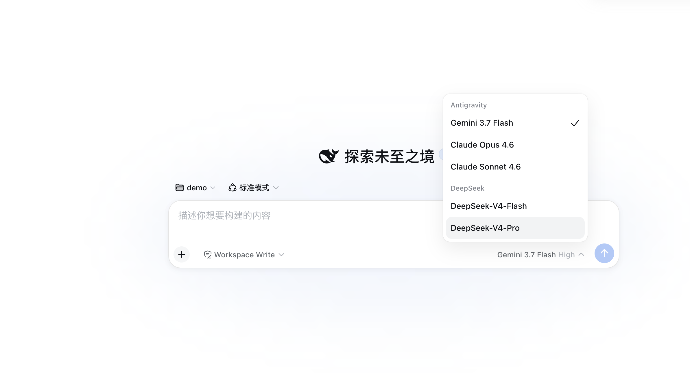
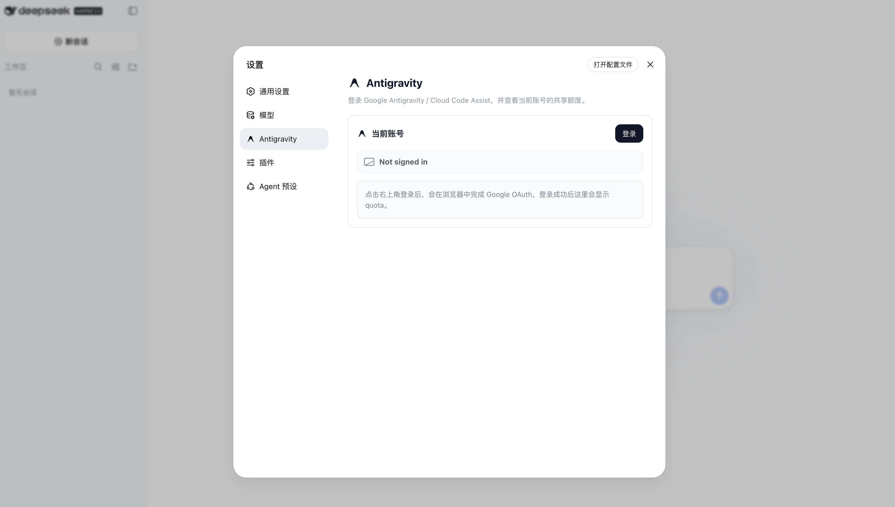
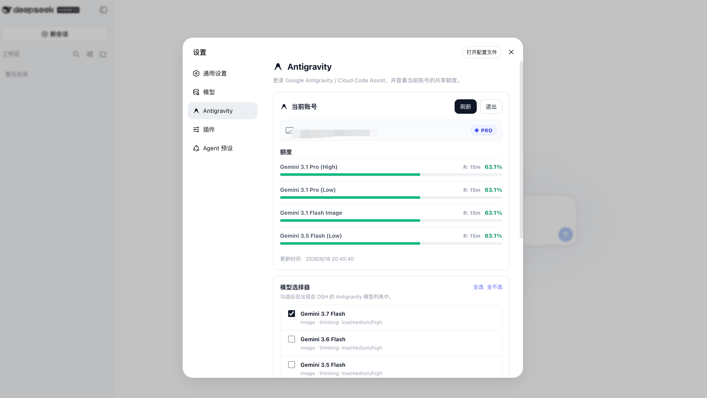

# dsh-antigravity

<p align="center">
  
</p>

English | [简体中文](./README.zh.md)

Google Antigravity / Cloud Code Assist model provider for
[DeepSeek Harness](https://github.com/deepseek-ai/deepseek-harness).

This is a DSH Web plugin. It registers a DSH `LlmAdapter`
under provider route `antigravity`, stores OAuth credentials under DSH home,
talks to the Cloud Code Assist streaming API directly, and provides full bilingual (English & Simplified Chinese) i18n support in the Web settings page.

> Unofficial integration. This project is not affiliated with or endorsed by
> Google. Use it only with accounts and services you are authorized to access.

## Install into DSH Web

### Option 1: Direct from GitHub

```sh
dsh plugin --profile web add github:LiZhenNet/dsh-antigravity
```

### Option 2: From Local Release Tarball

```sh
npm run pack:dist
dsh plugin --profile web add ./dist/dsh-antigravity-0.0.5.tgz
```

The package declares a DSH bundle patch, so installation automatically mounts
the host plugin and browser settings page.

If your DSH version does not support `dsh plugin add`, copy the package into
the Web profile manually:

```sh
cp -R dsh-antigravity "$DSH_HOME/profiles/web/node_modules/"
```

Then add the plugin to the profile `cordis.patch.yml`:

```yaml
- insert:
    - id: llm-antigravity
      name: dsh-antigravity
```

Restart DSH:

```sh
dsh web
```

## Login

Open **Settings > Antigravity** and click **Login**. The settings page starts
Google OAuth and refreshes quota after login completes.



After login, the settings page displays account information, quota grouped by model family, reset times, and model selector options:

- **Gemini Models** — Gemini Flash / Pro variants share one quota pool (green bars).
- **Claude and GPT models** — Claude Opus, Claude Sonnet, and GPT-OSS share a separate 3P quota pool (cyan bars).

Each group shows a **5-hour limit** (smooths short-term demand) and a **weekly limit** (tied to your subscription tier) with a live countdown to reset.



The plugin starts a loopback OAuth callback server at
`http://localhost:51121/oauth-callback`. If the Web service cannot open a
browser, run the terminal helper on the same machine:

```sh
node "$DSH_HOME/profiles/web/node_modules/dsh-antigravity/bin/antigravity-login.mjs"
```

Credentials are stored at:

```text
$DSH_HOME/storages/antigravity-oauth.json
```

Keep that file private. It contains access and refresh tokens.

## Models

After login, select the **Antigravity** provider in DSH's model picker. Use the
model selector in **Settings > Antigravity** to enable or disable individual
models (enabled models are prioritized at the top of the list) — the live remaining quota percentage is shown next to each one.

Registered model IDs:

| Model ID | Name | Quota pool |
|---|---|---|
| `gemini-3.8-flash` | Gemini 3.8 Flash | Gemini |
| `gemini-3.5-flash` | Gemini 3.5 Flash | Gemini |
| `gemini-3.1-flash-image` | Gemini 3.1 Flash Image | Gemini |
| `gemini-3-flash` | Gemini 3 Flash | Gemini |
| `gemini-2.5-pro` | Gemini 2.5 Pro | Gemini |
| `gemini-2.5-flash` | Gemini 2.5 Flash | Gemini |
| `claude-opus-4-6` | Claude Opus 4.6 | Claude & GPT (3P) |
| `claude-sonnet-4-6` | Claude Sonnet 4.6 | Claude & GPT (3P) |
| `gpt-oss-120b` | GPT-OSS 120B | Claude & GPT (3P) |

The plugin also carries base IDs for models that are **only served on paid
plans** or have been **retired upstream** — `gemini-4-argon`, `gemini-4-helium`,
`gemini-4-neon`, `gemini-4-krypton`, `gemini-nano-banana-2.1`,
`gemini-3.7-flash`, `gemini-3.6-flash`, `gemini-3.1-pro`. They are advertised
**only when the serving endpoint's live catalog actually lists them**, so a
free-tier account never sees a model it cannot call, and a paid account starts
seeing them again automatically after the account is upgraded (no plugin change
or re-login needed). Models that disappear from the catalog are also dropped
from the saved enabled-model list.

Models in the same quota pool share a weekly limit and a 5-hour limit. Quota is
consumed proportionally to token cost, so heavier models (e.g. Claude Opus)
drain the pool faster than lighter ones.

### Endpoints

The plugin talks to Cloud Code Assist over three interchangeable hosts, tried in
this order:

1. `https://daily-cloudcode-pa.googleapis.com` — **daily** endpoint, first
   choice.
2. `https://daily-cloudcode-pa.sandbox.googleapis.com` — its sandbox mirror.
3. `https://cloudcode-pa.googleapis.com` — prod, kept as a last resort.

Free-tier accounts are served by the daily endpoints; prod answers a
detail-free `429 RESOURCE_EXHAUSTED` for **every** model on those accounts,
which is why it is no longer first. Paid-tier accounts are the opposite way
round, hence prod is retained as a fallback instead of being removed. Override
the list with `ANTIGRAVITY_BASE_URL` (must be an `https` `*.googleapis.com`
host).

A `429` whose body carries no reset hint is reported as a retryable rate limit;
only an explicit `Individual quota reached` / `Resets in …` answer is treated as
real quota exhaustion. Failures are always reported for the **first** endpoint,
so the message reflects the host that should have served the request rather than
the last fallback.

### Coexistence with billion-context

If DSH also loads [billion-context](https://www.npmjs.com/package/billion-context),
its `dsh-native` client replaces `globalThis.fetch` and stamps every model request
with `x-bili-plugin: dsh`. On the Google lane that mark hands the request to
billion-context's ACP kernel, which decodes and rebuilds the `v1internal` body.
The rebuilt body makes upstream answer HTTP 200 with two frames, zero visible
characters and no terminal frame; billion-context then emits an in-band

```text
503 upstream stream ended before a completion event; this turn may be incomplete
```

and DSH surfaces it as a `TRANSPORT` error. This looks like a broken model or an
exhausted quota, but the endpoint and the account are fine.

To avoid it, the plugin sends `x-bili-passthrough: 1` on the streaming request
**only when it detects that billion-context's fetch interception is installed**
(`Symbol.for("billion-context.native-fetch-intercept") === true`). That makes
billion-context relay the Google lane byte-for-byte with its kernel bypassed,
which is what upstream expects. When billion-context is not present nothing is
added and behaviour is unchanged.

To opt out and let the kernel handle the lane again (for example after a
billion-context release fixes the Google path):

```sh
ANTIGRAVITY_BILI_PASSTHROUGH=0
```

Trade-offs worth knowing:

- **Tools keep working.** billion-context registers its tools (`absorb`,
  `compress`, `acp_status`, …) through DSH's tool registry and executes them over
  its own admin route, independent of whether the model lane is kernel-rewritten.
  Gemini can still call them.
- **No server-side compression on this lane.** A passthrough relay is not
  compressed by billion-context. DSH's own compression still works; only the
  proxy-side rewriting is skipped.

Equivalent alternative if you would rather not have the plugin involved: declare
the endpoints as passthrough routes in billion-context's own config
(`%USERPROFILE%\.config\billion-context\billion-context.json` on Windows):

```json
{
  "providers": {
    "https://daily-cloudcode-pa.googleapis.com": { "passthrough": true },
    "https://daily-cloudcode-pa.sandbox.googleapis.com": { "passthrough": true },
    "https://cloudcode-pa.googleapis.com": { "passthrough": true }
  }
}
```

billion-context reads that file only when its daemon starts, so restart DSH (or
the daemon) after editing it. Do not enable both this and the plugin header — they
do the same job.

### Reachability

This plugin talks to Google directly; there is no proxy setting of its own. The
machine must be able to reach `*.googleapis.com`. When it cannot, requests fail
with a `TRANSPORT` error wrapping the underlying `fetch failed` / `ETIMEDOUT` /
`ENOTFOUND`. If DSH runs behind a proxy, set `HTTPS_PROXY` (or `ALL_PROXY`) in
the Harness home `.env`; DSH installs an undici global dispatcher from it and
every plain `fetch()` in this plugin is covered.

## License

MIT
