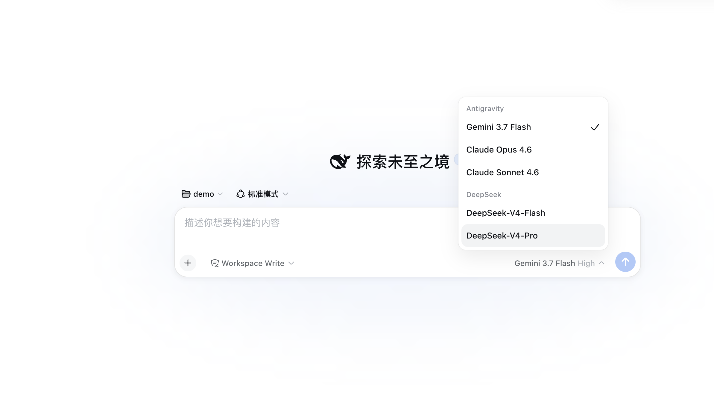
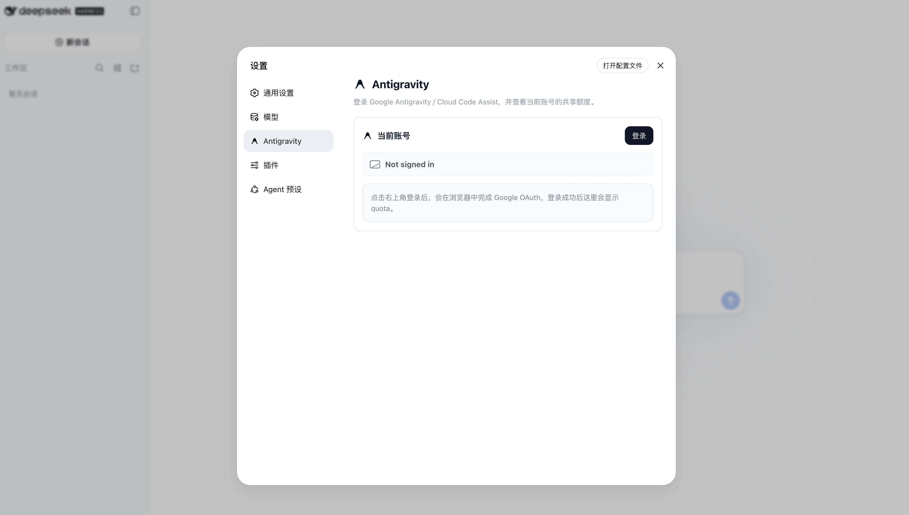
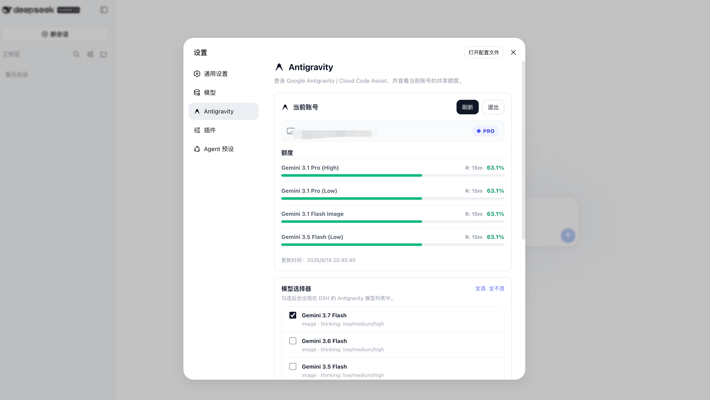

# dsh-antigravity

<p align="center">
  
</p>

[English](./README.md) | 简体中文

适用于 [DeepSeek Harness](https://github.com/deepseek-ai/deepseek-harness) 的 Google Antigravity / Cloud Code Assist 模型提供商插件。

这是一个 DSH Web 插件。它在 provider 路由 `antigravity` 下注册 DSH `LlmAdapter`，OAuth 凭证存储于 DSH home 目录下，直接与 Cloud Code Assist 流式 API 通信，并且 Web 设置页面完整支持中英文双语国际化（i18n）。

> 非官方集成。本项目与 Google 无关，亦未获得 Google 认可。请仅在您有权访问的账号和服务中使用。

---

## 安装到 DSH Web

### 方式一：直接从 GitHub 安装

```sh
dsh plugin --profile web add github:LiZhenNet/dsh-antigravity
```

### 方式二：通过本地 Release 包安装

```sh
npm run pack:dist
dsh plugin --profile web add ./dist/dsh-antigravity-0.0.5.tgz
```

该 package 声明了 DSH bundle patch，安装后会自动挂载 host 插件与浏览器设置页面。

如果您的 DSH 版本暂不支持 `dsh plugin add`，可手动复制到 Web profile：

```sh
cp -R dsh-antigravity "$DSH_HOME/profiles/web/node_modules/"
```

然后在 profile 的 `cordis.patch.yml` 中添加该插件：

```yaml
- insert:
    - id: llm-antigravity
      name: dsh-antigravity
```

重启 DSH：

```sh
dsh web
```

---

## 登录与授权

打开 **设置（Settings）> Antigravity** 并点击 **登录（Login）**。设置页面将发起 Google OAuth 授权流程，并在登录完成后自动刷新配额（Quota）。



登录成功后，设置页面将展示账号信息、按模型分组的实时配额进度条、重置倒计时以及模型选择器：

- **Gemini Models** —— Gemini Flash / Pro 变体共享同一个配额池（绿色进度条）。
- **Claude and GPT models** —— Claude Opus、Claude Sonnet 与 GPT-OSS 共享独立的 3P 配额池（青色进度条）。

每个分组均展示 **5 小时限额**（平滑短期突发用量）与 **每周限额**（绑定至订阅级别，如 Google AI Pro），并配有实时重置倒计时。



插件会在本地启动一个 loopback OAuth 回调服务（`http://localhost:51121/oauth-callback`）。如果 Web 服务无法自动唤起浏览器，可在同机器终端运行命令行登录助手：

```sh
node "$DSH_HOME/profiles/web/node_modules/dsh-antigravity/bin/antigravity-login.mjs"
```

凭证存储路径：

```text
$DSH_HOME/storages/antigravity-oauth.json
```

> 请妥善保管该文件，其中包含 access token 与 refresh token。

---

## 模型列表

登录后，在 DSH 模型选择器中选择 **Antigravity** 提供商。您可以在 **设置 > Antigravity** 的模型选择器中按需勾选或关闭单个模型（已勾选的模型将自动置顶展示），每个模型副标题均会显示其实时可用额度百分比。

支持注册的模型 ID：

| 模型 ID | 名称 | 额度池 |
|---|---|---|
| `gemini-3.8-flash` | Gemini 3.8 Flash | Gemini |
| `gemini-3.5-flash` | Gemini 3.5 Flash | Gemini |
| `gemini-3.1-flash-image` | Gemini 3.1 Flash Image | Gemini |
| `gemini-3-flash` | Gemini 3 Flash | Gemini |
| `gemini-2.5-pro` | Gemini 2.5 Pro | Gemini |
| `gemini-2.5-flash` | Gemini 2.5 Flash | Gemini |
| `claude-opus-4-6` | Claude Opus 4.6 | Claude & GPT (3P) |
| `claude-sonnet-4-6` | Claude Sonnet 4.6 | Claude & GPT (3P) |
| `gpt-oss-120b` | GPT-OSS 120B | Claude & GPT (3P) |

插件另外保留了几个**仅付费档提供**或**上游已下线**的基础 ID：`gemini-4-argon`、`gemini-4-helium`、`gemini-4-neon`、`gemini-4-krypton`、`gemini-nano-banana-2.1`、`gemini-3.7-flash`、`gemini-3.6-flash`、`gemini-3.1-pro`。它们**只有在当前服务端点的实时目录里真的存在时才会出现在模型选择器里**，所以免费档账号不会再看到「选了就 404」的模型；账号升级后目录里重新出现这些 ID 时会自动上架，无需改代码或重新登录。已经从目录里消失的模型也会同步从已启用列表里移除。

同一额度池内的模型共享 5 小时与每周额度。额度按 Token 成本比例扣除，因此较重的大模型（如 Claude Opus）消耗额度速度会快于轻量模型。

### 端点顺序

插件通过三个可互换的 Cloud Code Assist 主机访问服务，按以下顺序尝试：

1. `https://daily-cloudcode-pa.googleapis.com` —— **daily** 端点，首选。
2. `https://daily-cloudcode-pa.sandbox.googleapis.com` —— 其 sandbox 镜像。
3. `https://cloudcode-pa.googleapis.com` —— prod，仅作最后兜底。

免费档账号由 daily 端点服务；prod 端点对这类账号的**所有模型**都回一个不带任何细节的 `429 RESOURCE_EXHAUSTED`，因此它不再排第一。付费档账号恰好相反，所以 prod 被保留为兜底而不是删除。可用环境变量 `ANTIGRAVITY_BASE_URL` 覆盖整个列表（必须是 `https` 的 `*.googleapis.com` 主机）。

不带 reset 信息的裸 `429` 会被当作可重试的限流；只有明确带 `Individual quota reached` / `Resets in …` 的响应才判定为真实额度耗尽。错误信息一律以**首个**端点的失败原因为准，从而如实反映本应服务该请求的主机，而不是最后一个兜底端点。

插件会在可用时通过实时的 `fetchAvailableModels` 目录将这些公开 ID 解析为内部运行时模型 ID，并自带静态路由兜底。

### 与 billion-context 共存

如果 DSH 同时加载了 [billion-context](https://www.npmjs.com/package/billion-context)，它的 `dsh-native` 客户端会替换 `globalThis.fetch`，并给每个模型请求打上 `x-bili-plugin: dsh` 标记。在 Google 通道上，这个标记会让请求进入 billion-context 的 ACP 内核，由内核解码并重建 `v1internal` 请求体；重建后的请求体让上游返回 HTTP 200，但只有两帧、零个可见字符、且没有终止帧，于是 billion-context 就地合成一个带内错误：

```text
503 upstream stream ended before a completion event; this turn may be incomplete
```

DSH 侧看到的就是 `TRANSPORT`。这看起来像模型坏了或额度耗尽，实际上端点和账号都是好的。

为此，插件会在**检测到 billion-context 的 fetch 拦截确实装着时**（`Symbol.for("billion-context.native-fetch-intercept") === true`）给流式请求加上 `x-bili-passthrough: 1`，让 billion-context 对 Google 通道逐字节转发、绕过内核——这正是上游期望的形态。billion-context 不在场时不会加任何头，行为完全不变。

想退回内核处理（比如 billion-context 后续修好了 Google 通道），设：

```sh
ANTIGRAVITY_BILI_PASSTHROUGH=0
```

两点取舍值得知道：

- **工具照常可用。** billion-context 的工具（`absorb`、`compress`、`acp_status` 等）是通过 DSH 的工具注册表注册的，执行走它自己的 admin 路由，与模型通道是否被内核改写无关，Gemini 依然可以调用。
- **该通道不再有服务端压缩。** 逐字节转发不会被 billion-context 压缩；DSH 自身的压缩仍然有效，只是跳过了代理侧的改写。

如果不想让插件掺和，也可以在 billion-context 自己的配置里把这些端点声明为 passthrough 路由（Windows 上是 `%USERPROFILE%\.config\billion-context\billion-context.json`）：

```json
{
  "providers": {
    "https://daily-cloudcode-pa.googleapis.com": { "passthrough": true },
    "https://daily-cloudcode-pa.sandbox.googleapis.com": { "passthrough": true },
    "https://cloudcode-pa.googleapis.com": { "passthrough": true }
  }
}
```

billion-context 只在守护进程启动时读取该文件，改完需重启 DSH（或守护进程）。两种方式作用相同，不要同时开启。

### 网络可达性

本插件直连 Google，自身没有代理设置项，机器必须能访问 `*.googleapis.com`。不可达时请求会以 `TRANSPORT` 错误暴露底层的 `fetch failed` / `ETIMEDOUT` / `ENOTFOUND`。若 DSH 运行在代理之后，在 Harness home 的 `.env` 里设置 `HTTPS_PROXY`（或 `ALL_PROXY`）：DSH 会据此安装 undici 全局 dispatcher，本插件里所有普通 `fetch()` 都会自动走代理。

---

## 许可证

[MIT](./LICENSE)
